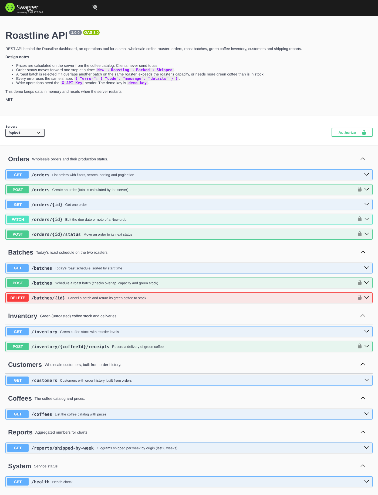
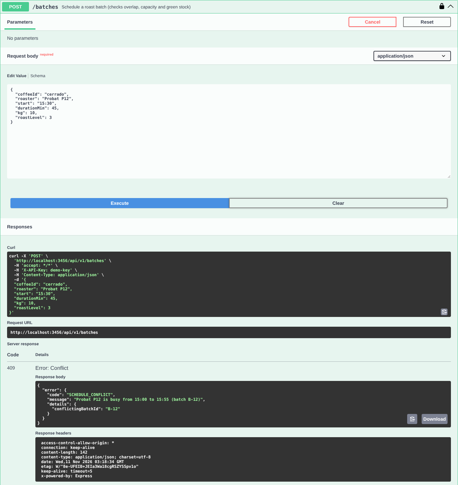

# Roastline API

REST API behind the [Roastline dashboard](../roastline-dashboard): an operations tool for a small wholesale coffee roaster. It covers orders, the daily roast schedule, green coffee inventory, customers and shipping reports.

**Stack:** Node.js 20+, Express 5, TypeScript, Zod (validation), OpenAPI 3 + Swagger UI, Vitest + Supertest.



## What it shows

- **Design-first API.** `openapi.yaml` was written before the code and is served as interactive docs at `/docs`. It passes `redocly lint`.
- **Business rules on the server, not the client:**
  - Order totals are calculated from the coffee catalog. A `total` sent by a client is ignored.
  - Order status can only move one step forward (`New → Roasting → Packed → Shipped`). Anything else returns `409 INVALID_TRANSITION` with the allowed next step.
  - Only `New` orders can be edited (`409 ORDER_LOCKED`).
  - A roast batch is rejected if it overlaps another batch on the same roaster (`409 SCHEDULE_CONFLICT`), is bigger than the roaster (`422`), or needs more green coffee than is in stock (`409 INSUFFICIENT_GREEN_STOCK`). Stock is checked for every origin in a blend before anything is deducted, and cancelling a batch puts the coffee back.
  - Deliveries can't overfill storage (`422 STORAGE_CAPACITY_EXCEEDED`).
- **One error shape everywhere:** `{ "error": { "code", "message", "details" } }`, with field-level details for validation errors, so the frontend can show messages next to the right input.
- **Filtering, search, sorting and pagination** on `GET /orders`.
- **API key** on write operations (`X-API-Key`, demo key `demo-key`). Reads are public.
- **25 automated tests** covering the happy paths and every error code.



## Run it

```bash
npm install
npm run dev        # http://localhost:3000/docs
npm test           # 25 tests
npm run build && npm start   # production build
```

Environment variables:

| Name | Default | Purpose |
|---|---|---|
| `PORT` | `3000` | Port to listen on |
| `API_KEY` | `demo-key` | Key required in `X-API-Key` for write operations |
| `CORS_ORIGIN` | (any) | Comma-separated list of origins allowed to call the API |

## Try it

```bash
# Orders due on Nov 6 that are still New, highest value first
curl "localhost:3000/api/v1/orders?status=New&dueFrom=2026-11-06&dueTo=2026-11-06&sort=-total"

# Create an order (the server calculates the total)
curl -X POST localhost:3000/api/v1/orders \
  -H "Content-Type: application/json" -H "X-API-Key: demo-key" \
  -d '{"customer":"Copperline Studio Café","city":"Seattle","due":"2026-11-09",
       "lines":[{"coffeeId":"nyeri","kg":5,"grind":"Filter"}]}'

# Try to skip a status step -> 409
curl -X POST localhost:3000/api/v1/orders/WH-2421/status \
  -H "Content-Type: application/json" -H "X-API-Key: demo-key" \
  -d '{"status":"Shipped"}'
```

## Endpoints

| Method | Path | Purpose |
|---|---|---|
| GET | `/api/v1/orders` | List with `status`, `dueFrom`, `dueTo`, `q`, `sort`, `page`, `pageSize` |
| POST | `/api/v1/orders` | Create an order |
| GET | `/api/v1/orders/{id}` | One order |
| PATCH | `/api/v1/orders/{id}` | Edit due date or note (New orders only) |
| POST | `/api/v1/orders/{id}/status` | Move to the next status |
| GET | `/api/v1/batches` | Roast schedule (optional `roaster`) |
| POST | `/api/v1/batches` | Schedule a batch |
| DELETE | `/api/v1/batches/{id}` | Cancel a batch |
| GET | `/api/v1/inventory` | Green stock with `ok` / `low` / `critical` levels |
| POST | `/api/v1/inventory/{coffeeId}/receipts` | Record a delivery |
| GET | `/api/v1/customers` | Customers built from orders |
| GET | `/api/v1/coffees` | Catalog and prices |
| GET | `/api/v1/reports/shipped-by-week` | Weekly kg shipped by origin |
| GET | `/api/v1/health` | Health check |

Full details, schemas and examples: `/docs` (Swagger UI) or `/openapi.json`.

## Project structure

```
openapi.yaml          API contract (source of truth for the docs)
src/
  domain.ts           Types and business rules (no Express code)
  seed.ts             Demo data
  store.ts            In-memory store; the only place to change for a real database
  http.ts             ApiError, validation helper, API key check, error handler
  routes/             One router per resource
  app.ts              Express app (createApp is used by tests and the server)
  server.ts           Starts the server
tests/api.test.ts     Vitest + Supertest
```

## Deploy (free) on Render

The repository includes a [Render Blueprint](render.yaml).

1. Push this repository to GitHub.
2. On [render.com](https://render.com): **New > Blueprint**, pick the repository.
3. Set `CORS_ORIGIN` to the dashboard's URL (e.g. `https://roastline-dashboard.netlify.app`), or leave it empty to allow any origin.
4. When the deploy finishes, the docs are at `https://<service>.onrender.com/docs`.

`API_KEY` is set to `demo-key` on purpose so visitors can try write operations in Swagger UI. Free Render services sleep when idle, so the first request can take 30–50 seconds.
